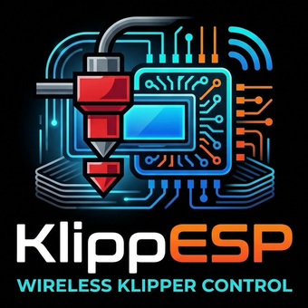

<p align="center"></p>

# KlippESP

A Klipper printer display for the **Waveshare ESP32-S3-Touch-LCD-7** (800×480). It talks to **Moonraker**, the same API Mainsail uses, over Wi-Fi, so nothing needs to be installed on the printer.

The display has two modes, chosen automatically at boot:

- **Touch UI:** used when the GT911 touch controller is present. A KlipperScreen-style interface for printing, temperatures, moving, extruding, fans, macros, console and power devices.
- **Status dashboard:** used when there's no touch panel. A read-only display with gauges, print progress and host stats, configured from a web page. Landscape or portrait.

## Status dashboard (no-touch)

- **Header:** printer state badge (printing, paused, heating, error, …), printer IP, display IP with Wi-Fi signal bars.
- **Hotend / Bed:** arc gauges colour-coded by state (cold, heating, at target), with target and heater power.
- **Sensors, fans and host:** a named list of chamber/Pi/MCU temperatures, every fan, and CPU, memory and disk. Long names are shortened so they always fit (e.g. *Nevermore* → *Filter*).
- **Printing:** thumbnail inside a progress ring, plus elapsed, remaining, layer, Z, speed, flow, part fan and filament tiles.
- **Idle:** large status icon with details, plus a host panel showing board model, OS, CPU/memory/disk bars, CPU temperature, uptime and under-voltage warnings.
- **Clear problem screens:** Wi-Fi setup, connecting, printer offline, Klipper starting or shut down (with Klipper's message).

## Touch UI

| Screen | What it does |
|---|---|
| **Home** | Temperatures, Klipper state, 9-tile menu; Restart / Firmware Restart when Klipper is in error |
| **Print** | Gcode files (newest first) with thumbnail, time, filament, layers and a Print button |
| **Printing** | Progress, times, layer, Z, temps, speed/flow/fan; Pause/Resume, Cancel, Reprint, Tune, Z offset. Opens automatically when a print starts |
| **Temperature** | Per-heater targets, ±1/5/10, keypad, PLA/PETG/ABS/TPU presets, cool down |
| **Move** | XY/Z jog, homing, QGL / Z-tilt / bed mesh when configured, motors off |
| **Extrude** | Preheat, length/speed, extrude/retract, Load/Unload macros |
| **Fans & Speed** | Speed factor, flow, part fan, `fan_generic` sliders |
| **Z Offset** | Live babystepping, reset, save to probe/endstop |
| **Macros · Console · Power** | Run macros, send G-code, toggle Moonraker power devices |
| **Settings** | Wi-Fi + printer IP on one screen, system actions, screen-off timer |

A red **E-STOP** is always in the top bar.

## Build & first flash

Install [PlatformIO](https://platformio.org/) **Core 6.1.19** (the pioarduino platform for Arduino core 3.3 /
ESP-IDF 5.5 doesn't work with Core 6.2: `pip install platformio==6.1.19`), connect the board by USB, then:

```bash
pio run -e waveshare_s3_lcd7 -t upload
```

If the upload doesn't start, hold **BOOT**, tap **RESET**, release BOOT, and retry.
The first build rebuilds the Arduino core libraries with custom ESP-IDF options (code runs from PSRAM so the panel
keeps refreshing during updates); it downloads ESP-IDF and takes about 15 minutes. Later builds are fast.

## Date & time

NTP client with a configurable server (default `pool.ntp.org`), a list of common time zones with automatic DST (or a
custom POSIX rule) and 12/24 h, set on the web settings page or over serial (`ntp=`, `tz=`, `clock24=`). The dashboard
header shows the day and time, the print view shows the ETA, file details show "done ~", and file dates are local.

## Setup

- **Setup hotspot / captive portal:** without Wi-Fi settings, or after 60 s without a connection, the display opens the Wi-Fi network **`KlippESP-Setup`**. Join it and the settings page opens automatically (otherwise browse to `http://192.168.4.1`). Choose your network, enter the password, the printer's IP, port **7125**, and the display orientation.
- **Settings page:** once connected, the same page is at the display's IP (shown on screen).
- **Serial (115200 baud):** `ssid=…`, `pass=…`, `host=…`, `port=…`, `apikey=…`, `rotate=0..3`, then `save`; `show` and `status` print the current state.

### Moonraker access

The display's IP must be allowed in `moonraker.conf` under `[authorization] trusted_clients` (MainsailOS allows private ranges by default). Otherwise get an API key from a trusted machine and enter it on the settings page:

```bash
curl http://<printer-ip>:7125/access/api_key
```

## Updating over Wi-Fi

After the first USB flash:

- **PlatformIO:** set `upload_port` in the `waveshare_s3_lcd7_ota` env to the display's IP, then run `pio run -e waveshare_s3_lcd7_ota -t upload`.
- **Browser:** settings page → **Firmware update** → upload `.pio/build/waveshare_s3_lcd7/firmware.bin`.
- **curl:** `curl -F fw=@.pio/build/waveshare_s3_lcd7/firmware.bin http://<display-ip>/update`

During an update the display shows a progress bar and restarts when done. Settings are kept. These endpoints are open to your LAN, so keep the display on a trusted network.

## Previewing without a printer

`tools/mock_moonraker.py` is a mock Moonraker server (standard library only) with simulated temperatures, prints and host stats. It also has a control page for switching scenarios (idle, heating, printing, paused, complete, error, Klipper shutdown, offline):

```bash
python3 tools/mock_moonraker.py
```

Point the display's printer IP at the machine running it (allow port 7125 in its firewall).

## Hardware notes

Pins and timings are in [src/board.h](src/board.h).

- **CH422G expander:** EXIO*n* is bit *n*; TP_RST = EXIO1, backlight = EXIO2, LCD_RST = EXIO3, SD_CS = EXIO4, USB_SEL = EXIO5 (keep it low for USB).
- **Image shifts sideways or flickers:** the panel streams its frame buffer from PSRAM. The firmware keeps LVGL's draw buffer in internal RAM and runs the pixel clock at 12 MHz. Lower `LCD_PCLK_HZ` further if needed.
- **Wi-Fi:** the PCB antenna sits behind the panel, so placement matters. The serial log prints signal strength and free memory every minute.
- **Brightness:** the backlight is on/off only.

## Tools

| Script | Purpose |
|---|---|
| `tools/mock_moonraker.py` | Mock printer for previewing every screen |
| `tools/gen_icons.py` | Regenerates the Material Design Icons subset fonts (needs Node.js) |
| `tools/gen_logo.py` | Regenerates the boot / web logo from `assets/logo_source.png` (needs Pillow) |

## Layout

```
src/board.*         RGB panel (esp_lcd, bounce buffers), GT911 touch, CH422G, LVGL driver
src/moonraker.*     background HTTP polling, commands, thumbnails, host stats
src/net.*           Wi-Fi, setup hotspot + captive portal, settings page, OTA, serial config
src/settings.*      settings stored in NVS
src/ui_dashboard.cpp  status dashboard (landscape + portrait)
src/ui_core.cpp     theme, navigation, dialogs, boot logo, update screen, touch home
src/ui_print.cpp    files, print status, Z offset (touch)
src/ui_control.cpp  temperature, move, extrude, fans, macros, power (touch)
src/ui_system.cpp   console, settings, connection, system (touch)
src/fonts/          generated icon fonts
include/lv_conf.h   LVGL 8.3 configuration
```

Icons: [Material Design Icons](https://pictogrammers.com/library/mdi/) (Apache-2.0).
