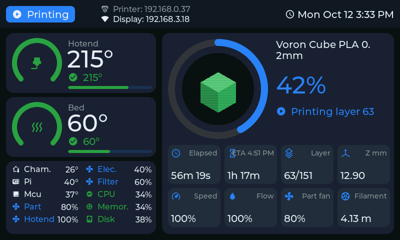
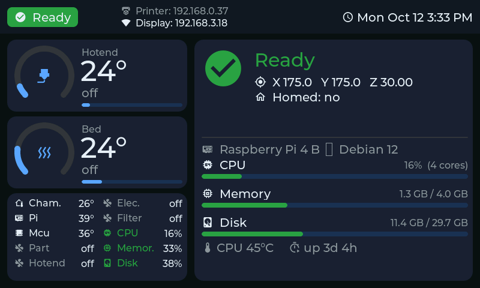
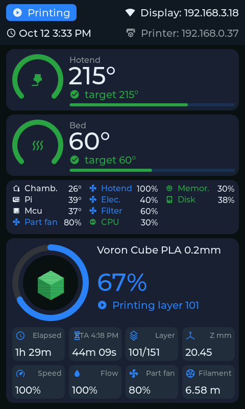
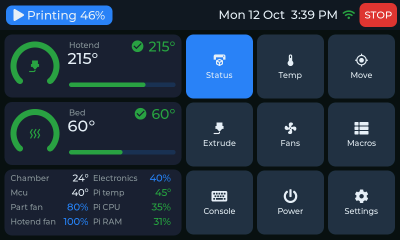
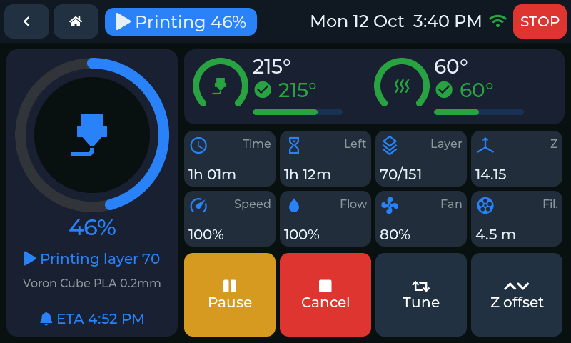
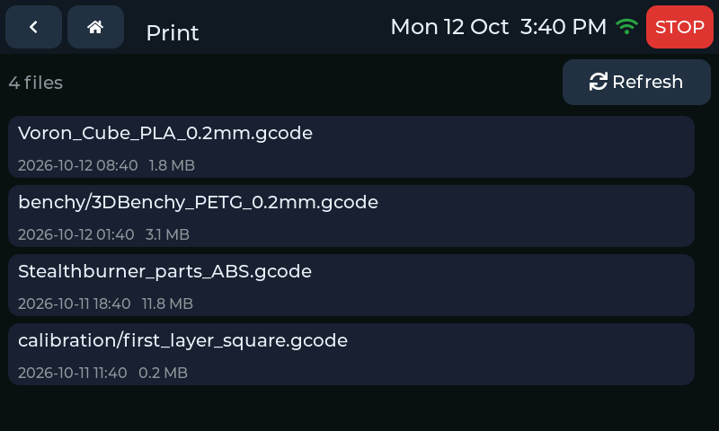
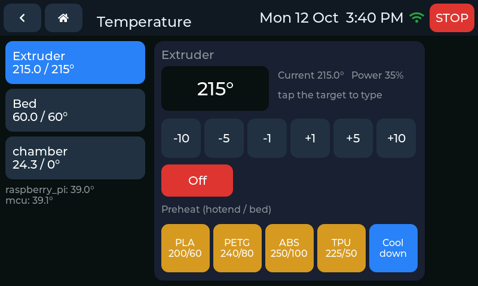
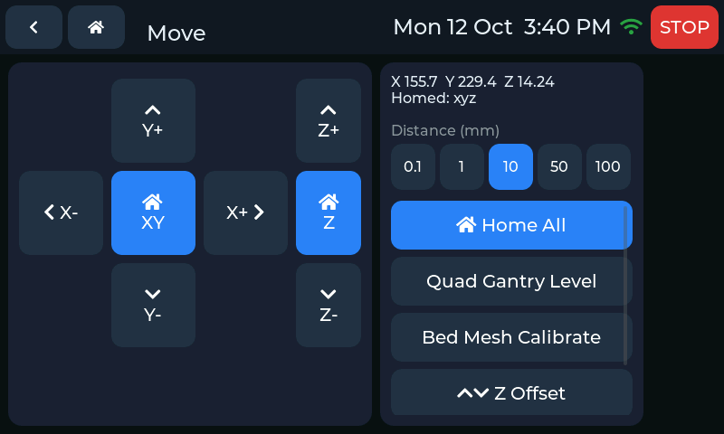
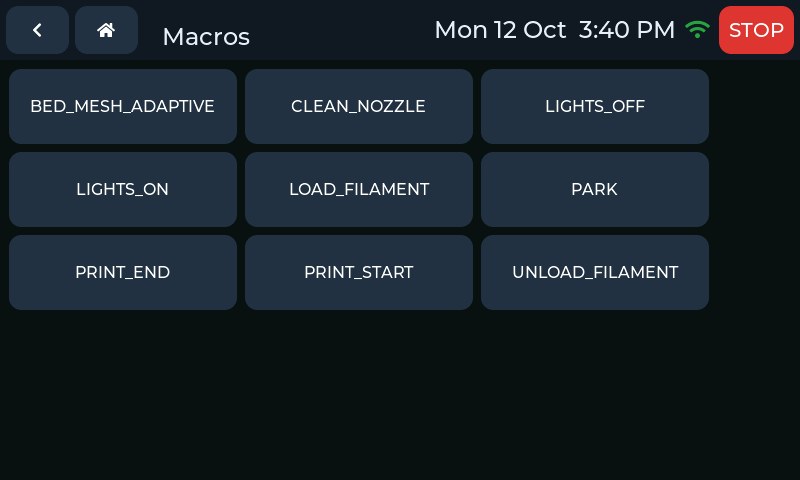

<p align="center"></p>

# KlippESP

**v1.3.0** · A Klipper printer display for ESP32 touch screens. It talks to **Moonraker** (the API Mainsail uses)
over Wi-Fi, so nothing needs to be installed on the printer. One code base, one build per display.

## Supported displays

| Display | Build | Highlights |
|---|---|---|
| **Waveshare ESP32-S3-Touch-LCD-7** (800×480, 8 MB PSRAM) | `waveshare_s3_lcd7` | Touch UI, or a read-only status dashboard for the no-touch version; slicer thumbnails; live update progress |
| **WT32-SC01 V3.3** (480×320, ESP32, no PSRAM) | `wt32_sc01` | Touch UI, dimmable backlight |

The touch UI scales to the panel: designed for 480×320, it grows 1.5× on the 800×480 Waveshare, with larger fonts so
text stays sharp. Every screen works in landscape and portrait.

## Screenshots

Captured from the Waveshare (800×480) with `/screenshot.bmp`, against the mock printer in `tools/`. The WT32 shows the
same touch UI at 480×320.

**Status dashboard** (no-touch Waveshare): printing, idle, portrait

<p>



</p>

**Touch UI**: Home, Printing, Files, Temperature, Move, Macros

<p>






</p>

## Touch UI

| Screen | What it does |
|---|---|
| **Home** | Hotend and bed gauges (arc: progress to target; bar: temperature against `max_temp`), sensors and fans, printer-host CPU temperature / CPU / RAM, 3×3 menu. When the printer is unavailable: a status card with Settings and Power (plus Restart / Firmware restart while Klipper is down) |
| **Print** | G-code files, newest first (up to 60), with details (time, filament, layers, thumbnail where supported) and a Print button |
| **Printing** | Progress ring, finish time, hotend / bed gauges, time, remaining, layer, Z, speed, flow, fan, filament; Pause / Resume, Cancel, Reprint, Tune, Z offset |
| **Temperature** | Per-heater targets, ±1/5/10, keypad, PLA / PETG / ABS / TPU presets, cool down |
| **Move** | XY / Z jog, homing, QGL / Z-tilt / bed mesh when configured, motors off |
| **Extrude** | Preheat, length / speed, extrude / retract, Load / Unload macros |
| **Fans & Speed** | Speed factor, flow, part fan, `fan_generic` sliders |
| **Z Offset** | Live babystepping, reset, save to probe / endstop |
| **Macros · Console** | Run macros (confirmed first), send G-code |
| **Power** | Moonraker power devices. With one device the Home tile shows its state and toggles it (asks first only while printing). Optional Klipper firmware restart after switching the printer on |
| **Settings** | Connection (Wi-Fi + printer), System (orientation, brightness where supported, screen-off timer, restarts, host reboot / shutdown), Power devices, Console, Date & Time, **About** |

The top bar shows the screen title (a live state badge on Home and Printing), the date and time, and a red **E-STOP**.

- **It follows the printer:** a print starting, pausing, finishing, being cancelled or failing opens the Printing page;
  Klipper going down returns to Home.
- **Screen off:** after an idle time you choose; a touch wakes it. It stays on while printing and wakes for updates.
- **Layers:** if the slicer doesn't send `SET_PRINT_STATS_INFO` (OrcaSlicer by default), the layer is estimated from
  Z and the file's layer heights, as Mainsail does.

## Status dashboard (Waveshare)

For the Waveshare without a touch layer. Choose it with **Interface** on the settings page: **Auto** shows it when no
touch panel answers at boot, **Status dashboard** always shows it, **Touch UI** forces the touch UI. Without touch,
the touch UI shows each screen in turn every 8 s.

- **Header:** state badge, printer and display IPs, Wi-Fi signal, date and time.
- **Hotend / Bed:** arc and bar gauges with target and heater power.
- **Sensors, fans and host:** named list (long names shortened to fit), CPU / memory / disk.
- **Printing:** slicer thumbnail in the progress ring, times with finish time, layer, Z, speed, flow, fan, filament.
- **Idle:** status plus a host panel (board, OS, CPU / memory / disk, CPU temperature, uptime, under-voltage).
- **Problem screens:** Wi-Fi setup, connecting, printer offline, Klipper starting or shut down.

## Setup

- **Setup hotspot / captive portal:** without Wi-Fi settings, or after 60 s without a connection, the display opens the
  Wi-Fi network **`KlippESP-Setup`**. Join it and the settings page opens by itself (or browse to `http://192.168.4.1`).
- **On a touch display:** Settings → Connection (Wi-Fi scan, password, printer IP, port, API key).
- **Settings page** (at the display's IP):
  - Wi-Fi network (with a scan), password
  - printer IP or hostname, Moonraker port (7125), API key
  - interface (dashboard displays), orientation, brightness (dimmable displays), screen-off time,
    *Restart Klipper after power on*
  - time zone, 12/24 h clock, NTP server
  - firmware update and an **About** section
- **Serial (115200 baud):** `ssid=`, `pass=`, `host=`, `port=`, `apikey=`, `rotate=0..3`, `ui=0..2`, `bri=10..255`,
  `sleep=<minutes>`, `pwrrestart=0|1`, `ntp=`, `tz=`, `clock24=0|1`, then `save`; `show` and `status` print the
  current state.

### Moonraker access

The display's IP must be allowed in `moonraker.conf` under `[authorization] trusted_clients` (MainsailOS allows private
ranges by default). Otherwise get an API key from a trusted machine and enter it on the settings page:

```bash
curl http://<printer-ip>:7125/access/api_key
```

To have Klipper come back by itself after a power device switches the printer on (from anywhere), add
`restart_klipper_when_powered: True` and `restart_delay: 3` to the device's `[power …]` section.

### Date & time

NTP with a configurable server (default `pool.ntp.org`), common time zones with automatic DST (or a custom POSIX
rule) and a 12/24 h clock. Used for the clock, the print finish time, "done ~" in file details and file dates.

## Build & flash

Install [PlatformIO](https://platformio.org/) **Core 6.2 or newer**, connect the display by USB, then build its
environment:

```bash
tools/pio run -e waveshare_s3_lcd7 -t upload
tools/pio run -e wt32_sc01 -t upload
```

`tools/pio` is plain `pio` with a separate PlatformIO directory per display. The Waveshare build recompiles the
Arduino core libraries with custom ESP-IDF options (code runs from PSRAM so the panel keeps refreshing while flash is
written); a build for another display in the same directory would replace them and force a ~15-minute rebuild. If you
only ever build one display, plain `pio` works too.

Waveshare upload doesn't start? Hold **BOOT**, tap **RESET**, release BOOT and retry.

### Updating over Wi-Fi

- **PlatformIO:** set `upload_port` in the display's `_ota` environment, then e.g.
  `tools/pio run -e wt32_sc01_ota -t upload`. The display shows a progress bar and restarts; settings are kept.
- **Browser / curl:** settings page → **Firmware update** → `.pio/build/<environment>/firmware.bin`, or
  `curl -F fw=@.pio/build/<environment>/firmware.bin http://<display-ip>/update`.
  **Known issue:** on the WT32 this upload drops partway through; use PlatformIO or USB there.

These endpoints are open to your LAN, so keep the display on a trusted network.

### Diagnostics

- `http://<display-ip>/info`: version, ESP-IDF, build time, uptime, free memory, LVGL pool and task stack headroom
  (JSON).
- `http://<display-ip>/screenshot.bmp`: what the screen shows right now (Waveshare; the WT32 panel keeps the image in
  its own memory).

## Versions and releases

The version is set in [src/version.h](src/version.h) and shown on the About screen, the web page and `/info`.
Releases are tagged `vX.Y.Z`.

## Previewing without a printer

`tools/mock_moonraker.py` is a mock Moonraker server (standard library only) with simulated temperatures, prints and
host stats, plus a control page for switching scenarios (idle, heating, printing, paused, complete, error, Klipper
shutdown, offline):

```bash
python3 tools/mock_moonraker.py
```

Point the display's printer IP at the machine running it (allow port 7125 in its firewall).

## Hardware notes

| | Waveshare ESP32-S3-Touch-LCD-7 | WT32-SC01 V3.3 |
|---|---|---|
| Panel | 800×480 RGB via ESP-IDF `esp_lcd`, frame buffer in PSRAM read through bounce buffers, 12 MHz pixel clock | ST7796 SPI (SCLK 14, MOSI 13, DC 21, CS 15, RST 22) via LovyanGFX |
| Touch | GT911 (probed at boot; some units have no touch layer) | FT6336U on I2C (SDA 18, SCL 19, INT 39, 0x38) |
| Backlight | on/off via the CH422G expander | PWM on GPIO 23, brightness 10–255 |
| Memory | 16 MB flash, 8 MB PSRAM | 4 MB flash, no PSRAM (~105 KB RAM free at runtime) |

- **CH422G (Waveshare):** EXIO*n* is bit *n*; TP_RST = EXIO1, backlight = EXIO2, LCD_RST = EXIO3, SD_CS = EXIO4,
  USB_SEL = EXIO5 (keep it low, or USB disconnects until a power cycle).
- **No PSRAM (WT32):** long lists are virtual (only the visible rows exist), LVGL has a fixed 36 KB pool and print
  thumbnails are not shown.

## Adding a display

1. Add a `BOARD_*` section to [src/board.h](src/board.h), a `src/board_<name>.cpp` with the panel / touch / LVGL
   driver, and its feature switches in [include/klippesp_config.h](include/klippesp_config.h).
2. Add an environment to `platformio.ini` (and a boot-logo size in `tools/gen_logo.py`).
3. Check every screen in both orientations.

## Tools

| Script | Purpose |
|---|---|
| `tools/pio` | `pio` with a PlatformIO directory per display |
| `tools/mock_moonraker.py` | Mock printer for previewing every screen |
| `tools/gen_icons.py` | Regenerates the Material Design Icons subset fonts (needs Node.js) |
| `tools/gen_logo.py` | Boot logo (per display) and web logo from `assets/logo_source.png` (needs Pillow) |
| `tools/touch_about.py` | PlatformIO pre-build step that keeps the About build time current |

## Layout

```
src/main.cpp               start-up: settings, Wi-Fi, display, boot logo, Moonraker, UI
src/board.h                board selection and capabilities
src/board_*.cpp            per-display panel, touch, backlight, LVGL driver
include/klippesp_config.h  per-display feature switches (PSRAM, thumbnails, dashboard, large fonts)
src/moonraker.*            background polling, commands, thumbnails, power devices, host stats, layer estimate
src/net.*                  Wi-Fi, setup hotspot + captive portal, settings page, OTA, /info, /screenshot.bmp, serial
src/settings.*, clock.*    settings in NVS; NTP + time zones
src/version.h, about.*     release version; About facts
src/ui_core.cpp            touch-UI framework: scaling, top bar, navigation, virtual lists, dialogs, update screen
src/ui_status.cpp          Home and Printing
src/ui_print.cpp           files, Z offset
src/ui_control.cpp         temperature, move, extrude, fans, macros, power
src/ui_system.cpp          console, settings, connection, system, date & time, about
src/ui_dashboard.cpp       status dashboard (Waveshare)
src/fonts/                 generated icon fonts
include/lv_conf.h          LVGL 8.3 configuration (per display via klippesp_config.h)
```

Icons: [Material Design Icons](https://pictogrammers.com/library/mdi/) (Apache-2.0).
